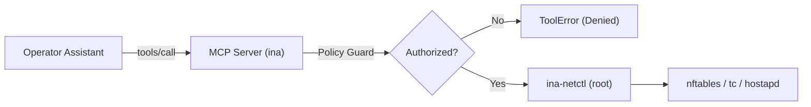

# INA v2 Implementation Reference

This document provides a comprehensive technical reference for the software architecture, Model Context Protocol (MCP) server, natural-language assistant, network enforcement modules, and rule-based policy engine implemented in **INA v2**.

---

## 1. System Components & Architecture

The implementation follows a strict separation of concerns across five core packages:

```text
code/
├── assistant/    # Control Plane: Operator CLI, prompt orchestration, LLM backends & fallback parser
├── mcp_server/   # Data Plane: FastMCP server, typed Pydantic schemas, Streamable HTTP & TLS transport
├── network/      # Data Plane: Kernel enforcement (nftables, tc, hostapd), verification & privileged helper
├── policy/       # Data Plane: Independent rule-based authorization, device registry & grant store
└── eval/         # Benchmarking: Functional, clarification & adversarial security evaluation
```

### Core Design Principles
1. **The AI Proposes, The Policy Decides, The Kernel Proves:** The assistant possesses zero administrative privileges. All administrative decisions are evaluated authoritatively by the router's policy engine.
2. **Strict Schema Constraints:** The LLM cannot execute arbitrary commands; it only populates strongly typed parameters validated by Pydantic schemas.
3. **Defense-in-Depth Isolation:** Privileged kernel calls run exclusively through `ina-netctl` via strict sudo permissions. The MCP server daemon (`ina`) runs unprivileged.
4. **Read-Back Verification & Rollback:** Every mutating network call is tested via post-mutation kernel queries (reachability or queue inspection); failed operations are rolled back atomically.

---

## 2. Operator Assistant (`code/assistant/`)

The assistant enables conversational network administration while defending against prompt injections, parameter hallucinations, and accidental misconfigurations.

### 2.1 Component Modules
- **`contract.py`:** Defines the typed data structures: `Intent`, `ToolCall`, `ExecutionResult`, `Decision`, and `ToolName`.
- **`intent.py`:** Deterministic, zero-dependency natural language parser. Handles regex and token-based intent extraction when no LLM is configured or when an external API call fails.
- **`llm.py`:** Multi-provider backend adapters:
  - `RuleBasedBackend`: Fully offline fallback parser using `intent.py`.
  - `AnthropicBackend`: Claude function-calling adapter using `anthropic` SDK.
  - `OpenAICompatibleBackend`: Standard library HTTP client supporting OpenRouter, Google Gemini, Ollama, Groq, and standard OpenAI `/chat/completions` endpoints.
- **`prompts.py`:** System prompts enforcing tool schemas, parameter extraction rules, and clarification guidelines.
- **`result_view.py`:** Filters raw execution outputs before presenting them to the LLM. Strips internal shell commands, kernel error strings, and file paths to prevent indirect prompt injection.
- **`transport.py`:** Handles communication with the MCP server:
  - `McpTransport`: Connects to the Raspberry Pi over Streamable HTTP with TLS, presenting the bearer role token. Also supports stdio subprocess spawning for local development.
  - `MockTransport`: In-memory mock server for offline unit tests and evaluation benchmarks.
- **`client.py`:** Main user interface and CLI orchestration loop (`python -m assistant`).

### 2.2 Intent & Clarification Flow
1. If the operator input is missing essential parameters (e.g. *"limit bandwidth"*, *"block"*), the assistant triggers a **Clarification State** instead of guessing defaults.
2. Destructive operations (such as `ban_client`) require explicit operator confirmation (`confirm=True`) before execution.

---

## 3. MCP Server Architecture (`code/mcp_server/`)

The MCP server runs on the Raspberry Pi 5 as a systemd service (`ina-mcp.service`) under the unprivileged service user `ina`.

### 3.1 Transport & Networking
- **Protocol:** Streamable HTTP (FastMCP) conforming to Model Context Protocol specification.
- **Endpoint:** `https://192.168.50.1:8443/mcp`
- **TLS Configuration:** Elliptic curve certificate (`P-256`) generated on the Pi.
- **Security Headers:** Strict inspection of `Host` and `Origin` headers prevents DNS rebinding attacks. Requests with unrecognized headers receive HTTP 421 (Misdirected Request) or HTTP 403 (Forbidden).

### 3.2 Authentication & Role Extraction (`auth.py`)
- Requests must include an `Authorization: Bearer <token>` header.
- The server extracts the client's source IP (from socket peer address).
- The token is verified against `/etc/ina/grants.json` (managed via `ina-netctl roles grant`).
- The grant maps the token to a person, an administrative role (`admin`, `operator`, `viewer`), and a registered physical device.
- If the token is invalid or used from an unauthorized IP address, the request is rejected with HTTP 401 Unauthorized.

---

## 4. The 8 Canonical MCP Tools

All tools are registered in `mcp_server/tools.py` with typed schemas from `mcp_server/schemas.py`.



### 4.1 `get_status`
- **Purpose:** Query connected Wi-Fi stations, active DHCP leases, active blocks, and bandwidth limits.
- **Parameters:**
  - `detailed` (`bool`, default: `False`): Include extended kernel telemetry.
- **Permitted Roles:** `viewer`, `operator`, `admin`.
- **Output:** `StatusResult` (list of active clients, IP/MAC addresses, lease expiry, active block targets, bandwidth rates).

### 4.2 `block_client`
- **Purpose:** Block network access for a client device at the packet filtering layer without disconnecting them from Wi-Fi.
- **Parameters:**
  - `client` (`str`): Hostname, IP address, or MAC address of the client.
  - `target` (`str`, default: `"all"`): Scope of block:
    - `"internet"`: Blocks forwarding through upstream interface `wlan0`.
    - `"gateway"`: Blocks host traffic to router `192.168.50.1` (except DHCP/DNS).
    - `"all"`: Complete quarantine (both internet and gateway).
    - `<peer-client>`: Blocks inter-station traffic between two specific clients.
- **Permitted Roles:** `operator`, `admin`.
- **Mechanism:** Inserts client IP into `table inet ina_filter set blocked_clients` or pair into `blocked_pairs`. Rejects traffic with ICMP `admin-prohibited`.

### 4.3 `unblock_client`
- **Purpose:** Remove an active block rule, restoring network access.
- **Parameters:**
  - `client` (`str`): Target client identifier.
  - `target` (`str`, default: `"all"`): Specific target scope or peer to unblock.
- **Permitted Roles:** `operator`, `admin`.
- **Mechanism:** Removes entry from `nftables` sets; verified by querying active kernel sets.

### 4.4 `limit_bandwidth`
- **Purpose:** Enforce egress and ingress traffic shaping on a client.
- **Parameters:**
  - `client` (`str`): Client hostname or IP.
  - `download_kbit` (`int`): Maximum download speed in kilobits per second.
  - `upload_kbit` (`int`): Maximum upload speed in kilobits per second.
- **Permitted Roles:** `operator` (2,000 to 20,000 kbit/s), `admin` (1,000 to 100,000 kbit/s).
- **Mechanism:** Allocates a Hierarchical Token Bucket (`htb`) class on `ap0` (download) and on Intermediate Functional Block `ifb-ap0` (upload). Packets matching client IP are classified via `cls_flower`.

### 4.5 `remove_bandwidth_limit`
- **Purpose:** Remove bandwidth rate limits for a client, returning to unconstrained throughput.
- **Parameters:**
  - `client` (`str`): Client identifier.
- **Permitted Roles:** `operator`, `admin`.
- **Mechanism:** Deletes the assigned `tc` filter and HTB class handle.

### 4.6 `kick_client`
- **Purpose:** Disconnect a client from the Wi-Fi network immediately.
- **Parameters:**
  - `client` (`str`): Client identifier.
  - `reason` (`str`, optional): Diagnostic reason string.
- **Permitted Roles:** `operator`, `admin`.
- **Mechanism:** Invokes `hostapd_cli -p /run/hostapd deauthenticate <mac>`. Station may immediately reconnect unless banned.

### 4.7 `ban_client`
- **Purpose:** Prevent a wireless station from associating with the access point.
- **Parameters:**
  - `client` (`str`): Client identifier.
  - `duration_minutes` (`int`, optional): Duration of ban. `0` or omitted indicates permanent ban (admin only). Operators are constrained to `<= 60` minutes.
  - `confirm` (`bool`, default: `False`): Confirmation flag.
- **Permitted Roles:** `operator` (temporary bans <= 60 min), `admin` (temporary or permanent).
- **Confirmation Flow:** When `confirm=False`, the tool returns a preview containing the client details, MAC, and proposed duration. When `confirm=True`, MAC is appended to `/etc/hostapd/hostapd.deny` and deauthenticated.

### 4.8 `unban_client`
- **Purpose:** Remove a station MAC from the wireless ban list.
- **Parameters:**
  - `client` (`str`): Client identifier or MAC address.
- **Permitted Roles:** `operator` (may only lift bans created by operators), `admin` (may lift any ban).
- **Mechanism:** Removes MAC from `/etc/hostapd/hostapd.deny`, reloads hostapd ACLs via `hostapd_cli unban <mac>`.

---

## 5. Linux Network Enforcement Primitives (`code/network/`)

### 5.1 Access Control (`access_control.py`)
Directs `nftables` via standard CLI commands:
- Manages table `inet ina_filter`.
- Enforces atomic set insertions (`nft add element inet ina_filter blocked_clients { <ip> }`).
- Implements rollbacks if post-execution state verification fails.

### 5.2 Bandwidth Shaping (`bandwidth.py`)
Utilizes Linux Traffic Control (`tc`):
- Root qdisc: Hierarchical Token Bucket (`htb`) on `ap0`.
- Ingress shaping: Ingress qdisc redirects packets via `act_mirred` to virtual device `ifb-ap0`, where HTB queues shape upstream traffic.
- Leaf scheduling: Stochastic Fairness Queueing (`sfq`) prevents single TCP flow starvation.

### 5.3 Wireless Control (`wireless.py`)
Interacts with the `hostapd` control socket at `/run/hostapd/ap0`:
- Station inspection (`hostapd_cli all_sta`).
- Deauthentication frames (`hostapd_cli deauthenticate <mac>`).
- Deny list persistence: Updates `/etc/hostapd/hostapd.deny` and signals daemon via `hostapd_cli reload_wpa_psk` or SIGHUP.

### 5.4 Device Discovery & Registration (`device_discovery.py`, `devices.py`)
- Reads `/var/lib/misc/dnsmasq.leases` for dynamic lease assignments.
- Inspects kernel ARP cache via `ip -4 neighbor show dev ap0`.
- Maps MAC addresses to friendly names from `policy/devices.yaml`.
- Enforces anti-spoofing bindings: `ina-netctl sync-devices` writes `/etc/ina/dhcp-hosts` and populates the `mac_ip_bind` set in nftables.

---

## 6. Policy Engine & Authorization (`code/policy/`)

Authoritative evaluation occurs on the router before any privileged helper is invoked.

### 6.1 Policy Rules (`policy/rules.yaml`)
- **Protected MACs & IPs:** Router gateway (`192.168.50.1`), admin workstations (`192.168.50.2`), and monitoring probes cannot be modified, blocked, kicked, or rate-limited.
- **Bandwidth Limits:** Min/max download and upload limits per role.
- **Ban Duration Constraints:** Max allowed ban time per role.

### 6.2 Roles Hierarchy (`policy/roles.yaml`)
| Role | Allowed Tools | Maximum Ban Duration | Rate Range | Unban Authority |
|---|---|---|---|---|
| **`viewer`** | `get_status` | None | None | None |
| **`operator`** | All tools | 60 minutes | 2,000 – 20,000 kbit/s | Operator-created bans only |
| **`admin`** | All tools | Unlimited (Permanent) | 1,000 – 100,000 kbit/s | All bans |

### 6.3 Policy Decisions
The engine evaluates requests and emits standardized decisions:
- `ALLOW`: Request conforms to role permissions, target boundaries, and device classes.
- `DENY`: Request violates policy (e.g. `R-protected-device`, `R-rate-range`, `R-role-action`, `R-unban-scope`).
- All decisions are recorded to `/var/log/ina-mcp/policy_audit.jsonl` with timestamp and unique `request_id`.

---

## 7. Verification & Atomic Rollback (`code/network/verification.py`, `service.py`)

Every mutation follows an atomic lifecycle:

```text
[Incoming Request]
       │
       ▼
 1. Schema Validation (Pydantic)
       │
       ▼
 2. Policy Authorization (PolicyGuard)
       │
       ▼
 3. Concurrency Lock Acquisition (/run/ina/ina.lock)
       │
       ▼
 4. Kernel Primitive Execution (nft / tc / hostapd)
       │
       ▼
 5. Read-Back Verification ────► [FAILED?] ──► 6. Execute Atomic Rollback
       │                                              │
       ▼ [VERIFIED]                                   ▼
 7. Update Persistent State (state.json)       Raise KernelMutationError
       │
       ▼
 8. Append Hash-Chained Audit Record (commands.jsonl)
       │
       ▼
 9. Return Structured Result to MCP Client
```

- **Verification of Blocks:** Executes ICMP ping to target IP; verifies that packet loss is 100% or that nftables drop counters increment.
- **Verification of Rate Limits:** Inspects `tc class show dev ap0` and `tc filter show dev ap0` to verify class existence and allocated rate parameters.
- **Verification of Bans:** Inspects `/etc/hostapd/hostapd.deny` and verifies station is disassociated via `hostapd_cli all_sta`.

