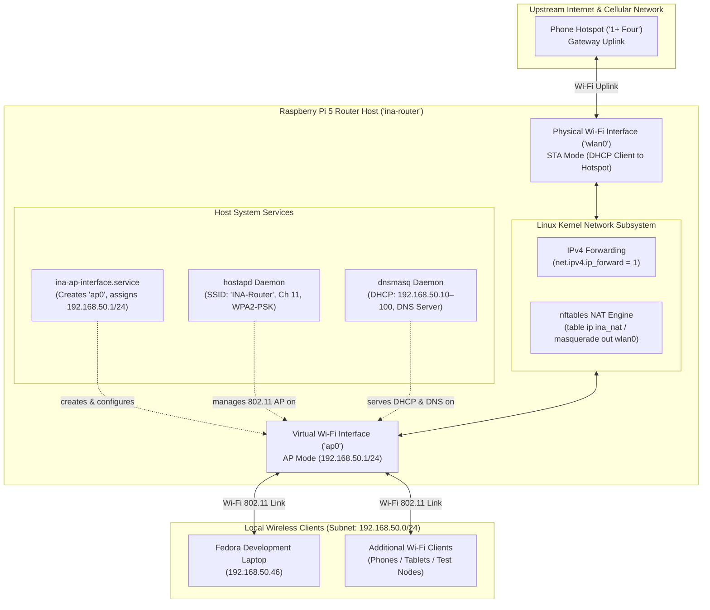
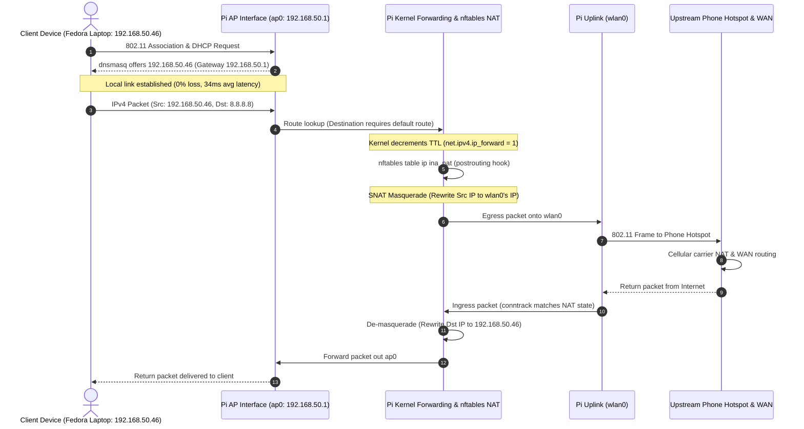

# INA v2 Architecture Reference

## 1. Overview & System Purpose

The **Intelligent Network Configuration Assistant v2 (INA v2)** is an automated network management and policy enforcement framework developed as a Computer Networks engineering project. The system provides natural-language driven network configuration, active telemetry, device discovery, and policy-governed traffic shaping over a dedicated test network.

In the verified system deployment, a **Raspberry Pi 5 (`ina-router`)** acts as the dedicated network infrastructure host, operating as a wireless access point and gateway router. Client devices—including a Fedora developer laptop—connect to the local network over Wi-Fi as standard wireless clients.



---

## 2. Network Topology & Interface Roles

The tested physical and logical topology cleanly decouples the uplink internet path from the local managed access point:

| Interface | Type | Role | IPv4 Configuration | Operational Responsibility |
| :--- | :--- | :--- | :--- | :--- |
| **`wlan0`** | Physical Wi-Fi (`brcmfmac`) | Internet Uplink (Station/STA mode) | Dynamic (Assigned via upstream DHCP) | Connects the Pi router to the upstream phone hotspot (`1+ Four`). Carries outbound internet traffic and default route. |
| **`ap0`** | Virtual Wi-Fi (`__ap` mode on `wlan0`) | Managed Access Point | Static: `192.168.50.1/24` | Broadcasts SSID `INA-Router` on 2.4 GHz Channel 11. Terminates client associations and local subnet routing. |
| **`eth0`** | Physical Gigabit Ethernet | Management / Standby | None assigned (Disconnected) | Reserved for optional out-of-band management or wired uplink. Not active in tested baseline. |
| **`lo`** | Virtual Loopback | Local IPC | `127.0.0.1/8`, `::1/128` | Host internal communication and local daemon binding. |

### Single-Radio Virtual Interface (`ap0`)

The Raspberry Pi 5 uses a single on-board wireless chip (`Broadcom/Cypress`). To simultaneously connect to an upstream Wi-Fi hotspot (`wlan0`) while providing an independent wireless access point (`ap0`), the Linux kernel utilizes mac80211/cfg80211 virtual interface capabilities (`type __ap`).

Both interfaces share the same underlying radio transceiver. Consequently, the virtual AP (`ap0`) operates on the physical radio channel constrained by the physical hardware.

---

## 3. Packet Data Flow & NAT Traversal



### Routing & Translation Components

1. **IPv4 Forwarding:** Enabled persistently via `/etc/sysctl.d/99-ina-router.conf` (`net.ipv4.ip_forward = 1`). Permits the Linux kernel to route packets between interfaces `ap0` and `wlan0`.
2. **Stateful NAT (`nftables`):** Packets leaving interface `wlan0` sourced from `192.168.50.0/24` are masqueraded using `table ip ina_nat`. The conntrack subsystem maintains translation tables to route inbound replies back to the appropriate local client.
3. **No Blanket Ruleset Flush:** The NAT table is isolated under `table ip ina_nat` and loaded without `flush ruleset`, preventing accidental erasure of unrelated system firewall policies.

---

## 4. Host System Services & Startup Ordering

The Raspberry Pi infrastructure relies on four core Linux daemons and systemd units:

```text
[Boot]
  │
  ├──> wlan0 initialized by kernel / NetworkManager connects to Hotspot
  │
  ├──> ina-ap-interface.service (creates ap0, sets link UP, assigns 192.168.50.1/24)
  │      │
  │      ├──> hostapd.service (binds to ap0, starts 802.11 beaconing)
  │      │
  │      └──> dnsmasq.service (binds to ap0, starts DHCP/DNS listener)
  │
  └──> nftables.service (loads table ip ina_nat masquerade rule)
```

1. **`ina-ap-interface.service`:** A systemd oneshot unit executing `/usr/local/sbin/ina-ap-interface.sh`. Creates virtual interface `ap0` on top of `wlan0`, sets link `UP`, and assigns static address `192.168.50.1/24`.
2. **`hostapd`:** Access point authentication daemon. Reads `/etc/hostapd/hostapd.conf`, binds to `ap0`, advertises SSID `INA-Router` on channel 11, and handles WPA2 4-way handshakes.
3. **`dnsmasq`:** Lightweight DHCP and DNS caching server. Reads `/etc/dnsmasq.d/ina-ap.conf`, listens on `ap0`, dynamically leases addresses from `192.168.50.10` to `192.168.50.100` (12-hour lease duration), and publishes gateway and DNS options.
4. **`nftables`:** Modern Linux packet filtering framework. Reads `/etc/nftables.conf` and applies postrouting masquerading rules for client egress traffic.

### Startup Race Resolution (Systemd Overrides)

Because `ap0` is created dynamically at boot, services attempting to bind to `ap0` prematurely (`hostapd` and `dnsmasq`) would fail if started before interface creation. Systemd drop-in override directories resolve this ordering:

- `/etc/systemd/system/hostapd.service.d/override.conf`: Establishes `BindsTo=sys-subsystem-net-devices-ap0.device` and `After=ina-ap-interface.service`.
- `/etc/systemd/system/dnsmasq.service.d/override.conf`: Establishes `After=ina-ap-interface.service hostapd.service`.

---

## 5. Architectural Separation: Infrastructure vs. Application Layer

A fundamental principle of the INA v2 design is the strict decoupling of the **Network Infrastructure Layer** from the **INA Application & Policy Layer**:

```text
┌────────────────────────────────────────────────────────────────────────┐
│                        INA APPLICATION LAYER                           │
│                                                                        │
│   ┌────────────────────────┐         ┌─────────────────────────────┐   │
│   │   Assistant Client     │         │   Policy & Auth Engine      │   │
│   │   (assistant/)         │         │   (policy/)                 │   │
│   └───────────┬────────────┘         └──────────────┬──────────────┘   │
│               │ MCP Protocol                        │ RBAC / Rules     │
│   ┌───────────▼─────────────────────────────────────▼──────────────┐   │
│   │                    FastMCP Server                              │   │
│   │                    (mcp_server/)                               │   │
│   └───────────────────────────┬────────────────────────────────────┘   │
│                               │ Safe Python Primitives                 │
│   ┌───────────────────────────▼────────────────────────────────────┐   │
│   │                    Network Control Layer                       │   │
│   │  • device_discovery.py (Host & Client ARP/DHCP Inspection)     │   │
│   │  • access_point.py    (Configuration & Router State Inspector) │   │
│   │  • access_control.py  (Firewall & Quarantine - Planned)        │   │
│   │  • bandwidth.py       (Traffic Shaping / QoS - Planned)        │   │
│   │  • verification.py    (Post-action State Checks - Planned)     │   │
│   └───────────────────────────┬────────────────────────────────────┘   │
└───────────────────────────────┼────────────────────────────────────────┘
                                │ System Calls / SSH / Local IPC
┌───────────────────────────────▼────────────────────────────────────────┐
│                    NETWORK INFRASTRUCTURE LAYER                        │
│                   (Raspberry Pi 5 / Debian Trixie)                     │
│                                                                        │
│   • Linux Kernel Subsystem (IPv4 Forwarding, nftables NAT, mac80211)   │
│   • Physical & Virtual Interfaces (wlan0 uplink, ap0 access point)     │
│   • System Daemons (hostapd, dnsmasq, systemd units)                  │
│   • Hardware Platform (Broadcom Wi-Fi, Quad-Core ARM Cortex-A76)       │
└────────────────────────────────────────────────────────────────────────┘
```

1. **Host Infrastructure Layer:** Configured and managed natively by the host operating system (Raspberry Pi OS / Debian). Runs independently of Python or MCP. If the assistant or MCP server is stopped or crashes, router functionality (AP, DHCP, NAT, forwarding) remains fully operational.
2. **INA Application Layer:** Software suite implementing natural language processing, tool registry, authorization policies, telemetry, and automated network operations. Can run locally on the Raspberry Pi or remotely on an operator workstation over secure transport.

---

## 6. Component Ownership & Implementation Status

| Component | Repository Path | Execution Host | Current Status | Notes |
| :--- | :--- | :--- | :--- | :--- |
| **Pi Access Point & Uplink** | `/etc/hostapd/`, `/etc/systemd/` | Raspberry Pi 5 | **Verified** | Reboot-persistent AP (`ap0`) and uplink (`wlan0`) tested. |
| **DHCP & DNS Services** | `/etc/dnsmasq.d/` | Raspberry Pi 5 | **Verified** | Leases `192.168.50.10–100` dynamically with 12h expiry. |
| **Routing & NAT Engine** | `/etc/nftables.conf`, sysctl | Raspberry Pi 5 | **Verified** | Forwarding active (`ip_forward=1`), NAT masquerade active. |
| **Host Network Discovery** | `network/device_discovery.py` | Pi or Dev Workstation | **Verified** | Inspects interfaces, routes, wireless driver capabilities. |
| **Client Device Discovery** | `network/device_discovery.py` | Raspberry Pi 5 | **Verified** | Parses `dnsmasq.leases` and `ip neigh` table. |
| **Router Status Inspector** | `network/access_point.py` | Raspberry Pi 5 | **Verified** | Validates config and inspects live systemd/nftables state. |
| **Access Control & Quarantine** | `network/access_control.py` | Raspberry Pi 5 | **Planned** | Skeleton docstring; live blocking not tested. |
| **Bandwidth Management / QoS** | `network/bandwidth.py` | Raspberry Pi 5 | **Planned** | Skeleton docstring; live traffic shaping not tested. |
| **Post-Action Verification** | `network/verification.py` | Raspberry Pi 5 | **Planned** | Skeleton docstring; verification hooks pending. |
| **FastMCP Server** | `mcp_server/` | Pi or Dev Workstation | **Planned** | Server skeleton created; tool schemas pending. |
| **Policy Engine & RBAC** | `policy/` | Pi or Dev Workstation | **Planned** | Declarative rules and role definitions pending. |
| **AI Assistant Client** | `assistant/` | Operator Workstation | **Planned** | Conversational prompt and client pipeline pending. |

---

## 7. Known Architectural Limitations

1. **Shared Wi-Fi Radio Channel:** Because `wlan0` and `ap0` operate on the same physical radio, simultaneous AP and STA operation must share radio time. Sustained traffic on both interfaces simultaneously impacts wireless throughput and latency.
2. **Cellular Uplink Variability:** The upstream internet uplink is provided by a mobile phone hotspot. Packet loss, variable latency, and cellular throttling are external factors beyond the router's local control.
3. **Client MAC Randomization:** Modern wireless clients generate randomized MAC addresses per SSID by default, which can result in multiple lease records for a single physical device across reconnects.
4. **Unassigned DHCP Hostnames:** Clients that do not transmit Option 12 in their DHCP requests are recorded with a hostname of `*` in `dnsmasq.leases`, requiring IP or MAC based identification.
