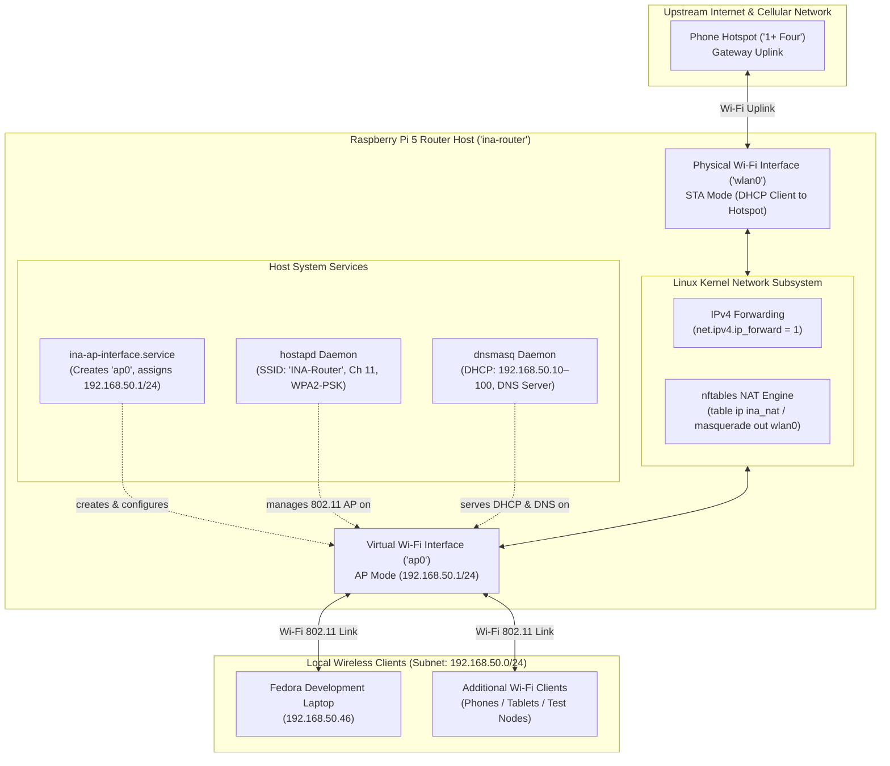
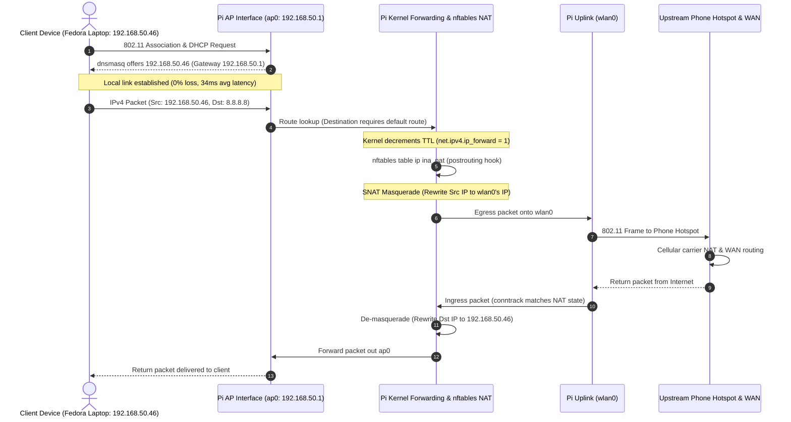

# INA v2 Architecture Reference

## 1. Overview & System Purpose

The **Intelligent Network Configuration Assistant v2 (INA v2)** is a natural-language network assistant developed as a Computer Networks engineering project. An operator's request is turned by an LLM into a Model Context Protocol (MCP) tool call, authorized by a policy engine on the router, applied with `nftables`, `tc` or `hostapd`, verified, logged, and explained back in plain English.

In the verified system deployment, a **Raspberry Pi 5 (`ina-router`)** acts as the dedicated network infrastructure host, operating as a wireless access point and gateway router. Client devices—including a Fedora developer laptop—connect to the local network over Wi-Fi as standard wireless clients.



---

## 2. Network Topology & Interface Roles

The tested physical and logical topology cleanly decouples the uplink internet path from the local managed access point:

| Interface | Type | Role | IPv4 Configuration | Operational Responsibility |
| :--- | :--- | :--- | :--- | :--- |
| **`wlan0`** | Physical Wi-Fi (`brcmfmac`) | Internet Uplink (Station/STA mode) | Dynamic (Assigned via upstream DHCP) | Connects the Pi router to the upstream phone hotspot (`1+ Four`). Carries outbound internet traffic and default route. |
| **`ap0`** | Virtual Wi-Fi (`__ap` mode on `wlan0`) | Managed Access Point | Static: `192.168.50.1/24` | Broadcasts SSID `INA-Router` on 2.4 GHz Channel 11. Terminates client associations and local subnet routing. |
| **`eth0`** | Physical Gigabit Ethernet | Management / Standby | None assigned (Disconnected) | Reserved for optional out-of-band management or wired uplink. Not active in tested baseline. |
| **`lo`** | Virtual Loopback | Local IPC | `127.0.0.1/8`, `::1/128` | Host internal communication and local daemon binding. |

### Single-Radio Virtual Interface (`ap0`)

The Raspberry Pi 5 uses a single on-board wireless chip (`Broadcom/Cypress`). To simultaneously connect to an upstream Wi-Fi hotspot (`wlan0`) while providing an independent wireless access point (`ap0`), the Linux kernel utilizes mac80211/cfg80211 virtual interface capabilities (`type __ap`).

Both interfaces share the same underlying radio transceiver. Consequently, the virtual AP (`ap0`) operates on the physical radio channel constrained by the physical hardware.

---

## 3. Packet Data Flow & NAT Traversal



### Routing & Translation Components

1. **IPv4 Forwarding:** Enabled persistently via `/etc/sysctl.d/99-ina-router.conf` (`net.ipv4.ip_forward = 1`). Permits the Linux kernel to route packets between interfaces `ap0` and `wlan0`.
2. **Stateful NAT (`nftables`):** Packets leaving interface `wlan0` sourced from `192.168.50.0/24` are masqueraded using `table ip ina_nat`. The conntrack subsystem maintains translation tables to route inbound replies back to the appropriate local client.
3. **No Blanket Ruleset Flush:** The NAT table is isolated under `table ip ina_nat` and loaded without `flush ruleset`, preventing accidental erasure of unrelated system firewall policies.

---

## 4. Host System Services & Startup Ordering

```text
[Boot]
  ├──> systemd-modules-load (ifb, sch_htb, sch_sfq, cls_flower, act_mirred)
  ├──> wlan0 joins the hotspot (NetworkManager)
  ├──> ina-ap-interface.service   creates ap0, 192.168.50.1/24, proxy_arp_pvlan, offloads off
  │      ├──> hostapd.service      AP on ap0 (ap_isolate=1, root-only control socket, deny list)
  │      ├──> dnsmasq.service      DHCP/DNS on ap0, reservations from /etc/ina/dhcp-hosts
  │      └──> ina-mcp.service      MCP server (user ina), HTTPS 192.168.50.1:8443
  ├──> nftables.service           table ip ina_nat + include /etc/nftables.d/ina-filter.nft
  │      └──> ina-reconcile.service (PartOf=nftables) re-applies blocks, limits, bans and
  │                                 MAC<->IP bindings from /var/lib/ina/state.json
  └──> ina-expire.timer           lifts expired bans every minute
```

1. **`ina-ap-interface.service`** runs `/usr/local/sbin/ina-ap-interface.sh`. It creates `ap0` on `wlan0` if it is missing, assigns `192.168.50.1/24`, enables forwarding and `proxy_arp_pvlan`, and disables segmentation offloads.
2. **`hostapd`** serves SSID `INA-Router` on channel 11 with WPA2-CCMP:
   - `ap_isolate=1`, so client↔client traffic passes through the Pi and can be filtered;
   - a root-only control socket for kick and ban;
   - `deny_mac_file` for bans.
3. **`dnsmasq`** leases `192.168.50.10–100` (12 h). It also reads the per-device reservations that `ina-netctl sync-devices` generates from `policy/devices.yaml`.
4. **`nftables`** loads NAT (`table ip ina_nat`) and the INA filter table (`inet ina_filter`), whose sets and chains enforce blocks and anti-spoofing.
5. **`ina-reconcile`**, **`ina-expire`** and **`ina-mcp`** are INA's own units (`config/systemd/`).

### Startup race resolution (systemd overrides)

`ap0` is created at boot, so `hostapd` and `dnsmasq` would fail if they started before it existed. Drop-ins order them:

- `/etc/systemd/system/hostapd.service.d/override.conf`: `BindsTo=sys-subsystem-net-devices-ap0.device`, `After=ina-ap-interface.service`.
- `/etc/systemd/system/dnsmasq.service.d/override.conf`: `After=ina-ap-interface.service hostapd.service`.

---

## 5. Application Layer

```text
OPERATOR LAPTOP                                         RASPBERRY PI 5 (ina-router)
┌─────────────────────────────────────┐                ┌──────────────────────────────────────────────────────┐
│ assistant/  (python -m assistant)    │                │ ina-mcp.service  [user ina]  mcp_server/              │
│  • LLM backend (any provider, .env)  │  HTTPS POST    │  • Streamable HTTP (stateless, JSON), TLS            │
│    or rule-based fallback parser     │  /mcp          │  • bearer token → 401 if invalid; Host/Origin checks │
│  • McpTransport (official MCP SDK)   │═══════════════►│  • inputSchema validation (SDK)                      │
│  • result view (no commands) → LLM   │  Bearer token  │  • PolicyGuard (policy/): token → person, role,      │
│  • reply checked against status      │◄═══════════════│    bound device → rules → policy audit log           │
└─────────────────────────────────────┘ structured      │  • NetctlService (network/privileged.py)             │
                                         result         └──────────────┬───────────────────────────────────────┘
                                                                       │ sudo -n /usr/local/sbin/ina-netctl --json
                                                                       │   --request-id <id> --role <role> <cmd> -- <args>
                                                        ┌──────────────▼───────────────────────────────────────┐
                                                        │ ina-netctl [root]  network/                          │
                                                        │  service.py: validate → lock → apply → verify →      │
                                                        │  rollback → state.json → audit.log                   │
                                                        │  each command → commands.jsonl (as it finishes)      │
                                                        │  nft (inet ina_filter) · tc (HTB/IFB) · hostapd_cli  │
                                                        └──────────────────────────────────────────────────────┘
```

### 5.1 Request workflow

| # | Step | Where |
|---|---|---|
| 1 | Operator types a natural-language request | `assistant/client.py` |
| 2 | Request goes to the LLM (or the rule-based parser if none is configured or it fails) | `assistant/llm.py`, `intent.py` |
| 3 | LLM chooses one tool and its arguments by native function calling over the server's `tools/list` schemas, or asks a question | `assistant/llm.py`, `prompts.py` |
| 4 | MCP client sends `tools/call` to the Pi over HTTPS with the role token | `assistant/transport.py` (`McpTransport`) |
| 5 | MCP server receives it, verifies the bearer token, checks Host/Origin and validates the arguments | `mcp_server/server.py`, `auth.py` |
| 6 | Policy check: token → person, role and bound device → rules (`R-*` decision), written to the policy audit | `policy/guard.py`, `engine.py` |
| 7 | Allowed call becomes the CLI command `sudo -n ina-netctl …` | `network/privileged.py` |
| 8 | Command runs as root: the service layer drives `nft`, `tc` or `hostapd_cli` | `network/netctl.py`, `service.py` |
| 9 | Each command's exit code and output are captured and logged as it finishes | `network/command_log.py` |
| 10 | Output goes back to the MCP server as a JSON envelope (result + command trace + request ID) | `network/netctl.py` |
| 11 | MCP server returns the structured result (failures as a fixed summary + reference ID) | `mcp_server/tools.py` |
| 12 | Client sends a whitelisted, command-free view to the LLM as the tool result in the same conversation | `assistant/result_view.py` |
| 13 | LLM writes the reply; it is accepted only if it echoes the real status, otherwise a template is used | `assistant/llm.py`, `client.py` |
| 14 | Reply is shown to the operator | `assistant/client.py` |

### 5.2 Trust boundaries

1. **LLM → MCP server.** The LLM only proposes. The server validates the schema and the policy, and the role comes from the token, never from the model. `confirm` for a ban is set only by a human y/N in the client.
2. **MCP server (user `ina`) → root.** Sudo allows exactly one command, `ina-netctl`, with typed subcommands and no shell (see [privilege_boundary.md](privilege_boundary.md)).
3. **Network → MCP server.** The server uses TLS and bearer tokens, and binds to the AP address. Clients blocked from the gateway cannot reach it.

### 5.3 Devices and roles

- **Every device on the Wi-Fi is a `client`.** Operators and admins may block, limit, kick or ban it.
- **`protected` devices** (listed by hand in `policy/devices.yaml`) can never be changed by any role.
- **Roles are granted by hand**, per person, bound to one registered device with a fixed IP: `sudo ina-netctl roles grant <person> <role> --device <device>`.
  - The token only works from that device's IP, which nftables anti-spoofing ties to its MAC.
  - A role holder cannot act on their own bound device.
  - Grants are hashed in `/etc/ina/grants.json` and re-read on change.
- **Admin vs operator** differ in limits only: rate range, ban duration, and which bans they may lift (`policy/roles.yaml`). The viewer can only read status.

### 5.4 Logs

| Log | Written by | Contents |
|---|---|---|
| `/var/log/ina-mcp/policy_audit.jsonl` | MCP server | Decision (person, role, tool, arguments, rule) and outcome (+ command summary) |
| `/var/log/ina/commands.jsonl` | `ina-netctl` (root) | Every command: argv, exit code, stdout/stderr, duration |
| `/var/log/ina/audit.log` | service layer (root) | Each change with its parameters and status |

All three are hash-chained and share the request ID assigned by the policy guard.

---

## 6. Component Status

See [implementation_status.md](implementation_status.md) for the full matrix. In short:

- **Router infrastructure:** verified on the Pi.
- **Application layer:** implemented and covered by unit tests, a real-kernel namespace lab (blocking) and live HTTPS round trips on a laptop.
- **Pending:** hardware validation of the application layer on the Pi.

---

## 7. Known Architectural Limitations

1. **Shared Wi-Fi radio.** `wlan0` and `ap0` share one radio, so heavy traffic on both lowers throughput and raises latency.
2. **Cellular uplink.** Loss, latency and throttling on the phone hotspot are outside the router's control.
3. **MAC randomisation.** A device that rotates its MAC appears as a new, unregistered client. MAC bans and registrations hold only while the device keeps its per-network MAC.
4. **Self-reported hostnames.** Leases show the name a device chose for itself unless it is registered (`sync-devices`). INA resolves registered names by MAC and never trusts the self-reported name for policy.
5. **Shaping vs airtime.** `tc` caps IP throughput, but a slow Wi-Fi client still consumes airtime.
6. **Service-account trust.** Whoever controls the `ina` account can call `sudo ina-netctl --role admin …` directly and skip the MCP policy guard. Protected-device and range checks still apply, and the account cannot change role grants.
