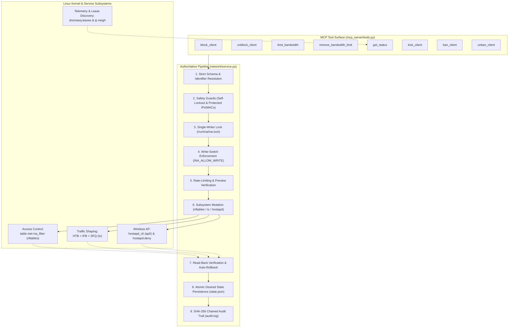

# INA v2 MCP Tools Reference & Implementation Guide

This document serves as the master technical specification and index for all Model Context Protocol (MCP) tools implemented in **INA v2**. 

INA v2 provides eight canonical tools designed to manage network access, shape bandwidth, monitor client associations, and enforce wireless station control on the INA local area network (`192.168.50.0/24`).

---

## 1. System Architecture & Authoritative Execution Pipeline

Every MCP tool invocation is strictly routed through the unified, single-writer `NetworkService` pipeline. This architecture ensures that callers (whether AI agents, CLI tools, or external orchestrators) cannot bypass validation, concurrency locking, or audit logging.

---

## 2. Master Tool Comparison Matrix

| Tool | Subsystem | Network Layer | Destructive? | Idempotent? | Read-Only? | Confirmation? | Detailed Documentation |
| :--- | :--- | :---: | :---: | :---: | :---: | :---: | :--- |
| [`block_client`](#31-block_client) | `nftables` | L3 / L4 IPv4 | **Yes** | **Yes** | No | No | [Detailed Doc](file:///home/dhruvv_w/Documents/ina/inav2/docs/tools/block_client.md) |
| [`unblock_client`](#32-unblock_client) | `nftables` | L3 / L4 IPv4 | No | **Yes** | No | No | [Detailed Doc](file:///home/dhruvv_w/Documents/ina/inav2/docs/tools/unblock_client.md) |
| [`limit_bandwidth`](#33-limit_bandwidth) | `tc` (HTB + IFB) | L3 Egress/Ingress | **Yes** | **Yes** | No | No | [Detailed Doc](file:///home/dhruvv_w/Documents/ina/inav2/docs/tools/limit_bandwidth.md) |
| [`remove_bandwidth_limit`](#34-remove_bandwidth_limit) | `tc` (HTB) | L3 Egress/Ingress | No | **Yes** | No | No | [Detailed Doc](file:///home/dhruvv_w/Documents/ina/inav2/docs/tools/remove_bandwidth_limit.md) |
| [`get_status`](#35-get_status) | Multi-subsystem | L2 - L4 Telemetry | No | **Yes** | **Yes** | No | [Detailed Doc](file:///home/dhruvv_w/Documents/ina/inav2/docs/tools/get_status.md) |
| [`kick_client`](#36-kick_client) | `hostapd_cli` | L2 Wi-Fi (802.11) | **Yes** | No | No | No | [Detailed Doc](file:///home/dhruvv_w/Documents/ina/inav2/docs/tools/kick_client.md) |
| [`ban_client`](#37-ban_client) | `hostapd` ACL & Deny | L2 Wi-Fi (802.11) | **Yes** | **Yes** | No | **Yes (Preview flow)** | [Detailed Doc](file:///home/dhruvv_w/Documents/ina/inav2/docs/tools/ban_client.md) |
| [`unban_client`](#38-unban_client) | `hostapd` ACL & Deny | L2 Wi-Fi (802.11) | No | **Yes** | No | No | [Detailed Doc](file:///home/dhruvv_w/Documents/ina/inav2/docs/tools/unban_client.md) |

---

## 3. Tool Overviews & Individual References

### 3.1 `block_client`
- **Scope:** Blocks IPv4 communication between a designated client and a target without deauthenticating the client from the Wi-Fi AP.
- **Key Characteristics:** The client remains connected to the AP. Its ARP neighbor entry remains active, and local DHCP (UDP 67) and DNS (UDP/TCP 53) remain fully operational. Dropped packets are rejected with `admin-prohibited` ICMP responses.
- **Targets:** Another peer client (bidirectional block), `gateway` (Pi host services except DHCP/DNS), `internet` (WAN uplink forwarding), or `all` (complete quarantine).
- **Implementation:** Adds IP tuples or single IPs to `nftables` sets in `inet ina_filter`. Confirmed via read-back verification; reverts atomically on command failure.
- 📖 **Full Specification & Implementation Guide:** [tools/block_client.md](file:///home/dhruvv_w/Documents/ina/inav2/docs/tools/block_client.md)

---

### 3.2 `unblock_client`
- **Scope:** Removes an active packet filtering rule between a client and a target peer, gateway, or uplink.
- **Key Characteristics:** Idempotent removal using `nft destroy element`. Leaves bandwidth shaping limits and wireless associations completely untouched.
- **Implementation:** Removes IP records from the target `nftables` set, confirms absence via read-back verification, and removes the entry from `state.json`.
- 📖 **Full Specification & Implementation Guide:** [tools/unblock_client.md](file:///home/dhruvv_w/Documents/ina/inav2/docs/tools/unblock_client.md)

---

### 3.3 `limit_bandwidth`
- **Scope:** Enforces aggregate download and upload bandwidth rate limits on a client across all destinations combined.
- **Key Characteristics:** Accepts download and upload ceilings between 256 kbit/s and 20,000 kbit/s (20 Mbit/s). Operates independently of packet blocking rules.
- **Implementation:** Utilizes Linux `tc` Hierarchical Token Bucket (`htb`) and Stochastic Fairness Queueing (`sfq`). Applies egress shaping directly on `ap0` and ingress shaping via redirection to the Intermediate Functional Block (`ifb-ap0`) device.
- 📖 **Full Specification & Implementation Guide:** [tools/limit_bandwidth.md](file:///home/dhruvv_w/Documents/ina/inav2/docs/tools/limit_bandwidth.md)

---

### 3.4 `remove_bandwidth_limit`
- **Scope:** Dismantles active traffic shaping classes for a client, restoring unconstrained physical line-rate performance.
- **Key Characteristics:** Removes the dedicated `htb` class and `flower` classifier filters from `ap0` and `ifb-ap0`. Does not touch firewall blocking rules or Wi-Fi connectivity.
- **Implementation:** Deletes tc classes by class ID derived from the client's host IP octet (`1:100 + octet`). Confirms class absence in kernel tables.
- 📖 **Full Specification & Implementation Guide:** [tools/remove_bandwidth_limit.md](file:///home/dhruvv_w/Documents/ina/inav2/docs/tools/remove_bandwidth_limit.md)

---

### 3.5 `get_status`
- **Scope:** Provides a comprehensive read-only snapshot of network activity, active leases, client associations, packet blocks, bandwidth limits, and active bans.
- **Key Characteristics:** Safe and idempotent. Evaluates running kernel state against persistent desired state (`state.json`) to detect and report configuration drift (`drift_detected`). Accessible by all roles, including `viewer`.
- **Implementation:** Aggregates live data from `dnsmasq.leases`, `ip neigh`, `nft -j list sets`, `tc -j class show`, and `state.json`.
- 📖 **Full Specification & Implementation Guide:** [tools/get_status.md](file:///home/dhruvv_w/Documents/ina/inav2/docs/tools/get_status.md)

---

### 3.6 `kick_client`
- **Scope:** Sends a one-time 802.11 deauthentication frame to a target wireless station, terminating its current Wi-Fi session.
- **Key Characteristics:** The client is not banned; standard devices will immediately renegotiate and reconnect within seconds. Governed by a sliding-window rate limit (maximum 3 kicks per MAC per 10 minutes) to prevent deauth flooding.
- **Implementation:** Invokes `hostapd_cli -i ap0 deauthenticate <mac>`. Verifies station disconnection by inspecting `sta <mac>` output and tracking `connected_time`.
- 📖 **Full Specification & Implementation Guide:** [tools/kick_client.md](file:///home/dhruvv_w/Documents/ina/inav2/docs/tools/kick_client.md)

---

### 3.7 `ban_client`
- **Scope:** Denies a device (by MAC address) from associating with the INA Wi-Fi network and immediately disconnects it if currently active.
- **Key Characteristics:** Enforces a mandatory **preview-then-confirm** workflow (`confirm=true` required). Supports timed bans (1 to 10,080 minutes / 7 days) or permanent bans. Automatically expired by the systemd `ina-expire` timer.
- **Implementation:** Adds MAC to `hostapd` runtime ACL (`deny_acl ADD_MAC`), atomically appends to `/etc/hostapd/hostapd.deny`, and sends deauthentication. Reverts runtime ACL and deny file if execution fails.
- 📖 **Full Specification & Implementation Guide:** [tools/ban_client.md](file:///home/dhruvv_w/Documents/ina/inav2/docs/tools/ban_client.md)

---

### 3.8 `unban_client`
- **Scope:** Removes an active Layer 2 ban from a device, allowing its MAC address to reassociate with the Wi-Fi AP.
- **Key Characteristics:** Resolves offline devices by querying historical records in `state.json`. Idempotent if device is not currently banned.
- **Implementation:** Removes MAC from runtime ACL (`deny_acl DEL_MAC`) and atomically removes it from `/etc/hostapd/hostapd.deny`.
- 📖 **Full Specification & Implementation Guide:** [tools/unban_client.md](file:///home/dhruvv_w/Documents/ina/inav2/docs/tools/unban_client.md)

---

## 4. Shared Safety & Reliability Guarantees

All eight tools operate within an enterprise-grade reliability harness:

1. **Single-Writer Concurrency:** A POSIX filesystem lock (`/run/ina/ina.lock`) serializes all mutating operations, eliminating race conditions between concurrent MCP calls or CLI commands.
2. **Infrastructure Protection:** The Raspberry Pi router (`192.168.50.1`), uplink infrastructure, and gateway MACs cannot be blocked, rate limited, kicked, or banned.
3. **Self-Lockout Prevention:** The caller's incoming session (`SSH_CLIENT`) is checked before kicking or banning to prevent administrators from severing their own management connection.
4. **Write-Switch Safety:** The environment variable `INA_ALLOW_WRITE=0` safely disables all mutating commands during dry-runs or maintenance windows.
5. **Tamper-Evident Audit Logging:** Every outcome (including dry-run previews, policy denials, and execution errors) is recorded to `/var/log/ina/audit.log` using a SHA-256 hash-chained JSON log entry.
6. **Reconciliation on Boot:** Systemd service `ina-reconcile.service` automatically reads `/var/lib/ina/state.json` on system boot to restore all active packet blocks, traffic limits, and MAC bans into the running kernel.

---

## 5. Index to Individual Tool Documentation Files

For in-depth parameters, JSON-RPC schemas, sequence diagrams, and command-line examples, consult the dedicated documentation files:

- [📄 `block_client.md`](file:///home/dhruvv_w/Documents/ina/inav2/docs/tools/block_client.md)
- [📄 `unblock_client.md`](file:///home/dhruvv_w/Documents/ina/inav2/docs/tools/unblock_client.md)
- [📄 `limit_bandwidth.md`](file:///home/dhruvv_w/Documents/ina/inav2/docs/tools/limit_bandwidth.md)
- [📄 `remove_bandwidth_limit.md`](file:///home/dhruvv_w/Documents/ina/inav2/docs/tools/remove_bandwidth_limit.md)
- [📄 `get_status.md`](file:///home/dhruvv_w/Documents/ina/inav2/docs/tools/get_status.md)
- [📄 `kick_client.md`](file:///home/dhruvv_w/Documents/ina/inav2/docs/tools/kick_client.md)
- [📄 `ban_client.md`](file:///home/dhruvv_w/Documents/ina/inav2/docs/tools/ban_client.md)
- [📄 `unban_client.md`](file:///home/dhruvv_w/Documents/ina/inav2/docs/tools/unban_client.md)

