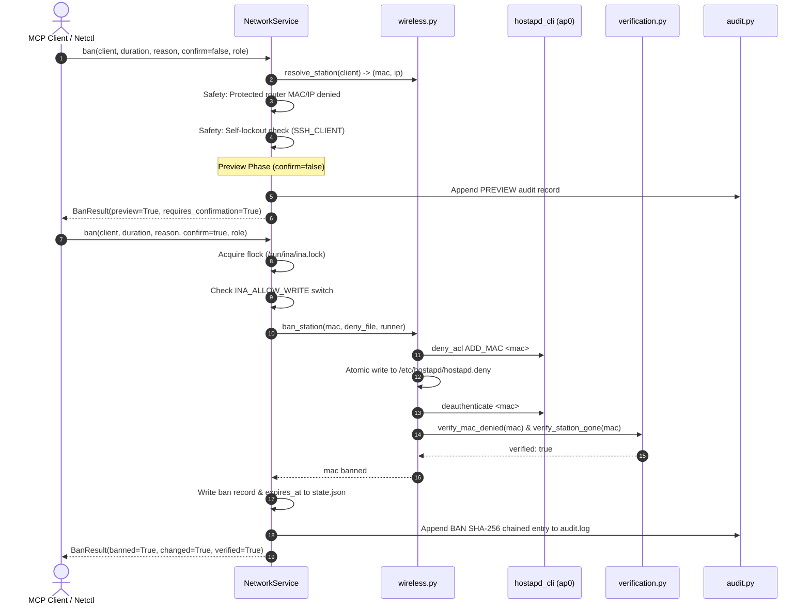

# Tool Reference: `ban_client`

The `ban_client` tool prevents a target device (by hardware MAC address) from associating with the INA Wi-Fi network and immediately deauthenticates it if currently connected.

---

## 1. Scope & Network Semantics

### What the Tool Does

- **Layer 2 (802.11) Association Block:** Adds the station's MAC address to `hostapd`'s runtime MAC Access Control List (`deny_acl`) and writes it atomically to the persistent deny file (`/etc/hostapd/hostapd.deny`).
- **Immediate Disconnection:** If the client is currently associated, a deauthentication frame is dispatched immediately.
- **Persistent & Reconnect Prevention:** When the client attempts to reconnect, the access point rejects its 802.11 Authentication frames at Layer 2.
- **Preview-Then-Confirm Workflow:** For safety against accidental lockouts, calling `ban_client` without `confirm=true` returns a dry-run **preview** of the pending ban (`requires_confirmation=true`). No hardware changes or state writes occur until called with `confirm=true`.
- **Timed Expiry:** Supports timed bans (from 1 minute up to 10,080 minutes / 7 days). Bans are automatically cleaned up upon expiration by the `ina-expire.service` daemon.

### What the Tool Leaves Untouched

- **IP Packet Filtering:** Does not create or remove `nftables` rules in `inet ina_filter`.
- **Bandwidth Limits:** Does not modify `tc` bandwidth classes.
- **Other Associated Stations:** Unaffected devices continue operating normally.

---

## 2. API & Schema Specification

### Input Arguments (`BanClientArgs`)

| Parameter            | Type               |   Required   | Constraints / Validation                                                                             | Description                                                                                                       |
| :------------------- | :----------------- | :-----------: | :--------------------------------------------------------------------------------------------------- | :---------------------------------------------------------------------------------------------------------------- |
| `client`           | `string`         | **Yes** | Pattern: `^([a-z0-9][a-z0-9-]{0,62}\|192\.168\.50\.[0-9]{1,3}\|[0-9a-fA-F]{2}(:[0-9a-fA-F]{2}){5})$` | Client reservation name (e.g. `phone-b`), IPv4 address, or MAC address.                                         |
| `duration_minutes` | `integer \| null` |      No      | Range: `1` to `10080` (minutes)                                                                  | Ban duration in minutes (default `null` = permanent ban). If caller is `operator`, maximum allowed is `60`. |
| `reason`           | `string \| null`  |      No      | Pattern: `^[A-Za-z0-9 .,_-]{0,120}$`                                                               | Optional short diagnostic or administrative reason string (max 120 chars).                                        |
| `confirm`          | `boolean`        |      No      | Default: `false`                                                                                   | Must be `true` to execute the ban. If `false`, returns a dry-run preview.                                     |

### Return Model (`BanResult`)

| Field                     | Type              | Description                                                                |
| :------------------------ | :---------------- | :------------------------------------------------------------------------- |
| `client`                | `string`        | Client identifier provided in invocation.                                  |
| `client_ip`             | `string \| null` | Resolved IPv4 address, if known.                                           |
| `mac`                   | `string`        | Normalized colon-separated MAC address.                                    |
| `preview`               | `boolean`       | `true` if this was a dry-run preview and no changes were made.           |
| `requires_confirmation` | `boolean`       | `true` if the ban must be confirmed to take effect.                      |
| `banned`                | `boolean`       | `true` if the station's MAC is denied following this call.               |
| `changed`               | `boolean`       | `true` if a new ban was applied; `false` if already banned or preview. |
| `verified`              | `boolean`       | `true` if deny ACL, deny file, and station absence were confirmed.       |
| `currently_associated`  | `boolean`       | `true` if the station is currently associated with the AP.               |
| `expires_at`            | `string \| null` | ISO-8601 UTC timestamp of ban expiration, or `null` if permanent.        |
| `message`               | `string \| null` | Diagnostic details or verification output.                                 |

### MCP Annotations & Permissions

- **MCP Annotations:** `destructive_hint=True`, `idempotent_hint=True`, `open_world_hint=False`, `read_only_hint=False`.
- **Role Requirements:**
  - `admin`: Can issue permanent bans or timed bans up to 10,080 minutes (7 days).
  - `operator`: Capped at maximum 60 minutes (`OPERATOR_MAX_BAN_MINUTES`). Permanent bans are rejected.
  - `viewer`: Denied.

---

## 3. Implementation Details

- **MCP Wrapper:** [`inav2/mcp_server/tools.py`](../../mcp_server/tools.py) (`ban_client`)
- **Authoritative Pipeline:** [`inav2/network/service.py`](../../network/service.py) (`NetworkService.ban`)
- **Wireless Primitive:** [`inav2/network/wireless.py`](../../network/wireless.py) (`ban_station`)
- **Wireless Verification:** [`inav2/network/verification.py`](../../network/verification.py) (`verify_mac_denied`, `verify_station_gone`)

### Underlying Commands & File Operations

```bash
# 1. Add MAC to hostapd runtime deny ACL:
hostapd_cli -i ap0 deny_acl ADD_MAC 3a:1f:9c:22:7e:10

# 2. Append MAC to atomic deny file (/etc/hostapd/hostapd.deny):
# (Written via temporary file write and atomic os.replace)

# 3. Disconnect station if active:
hostapd_cli -i ap0 deauthenticate 3a:1f:9c:22:7e:10
```

---

## 4. Execution Flow & Lifecycle Safeguards



### Rollback on Failure

If appending to `/etc/hostapd/hostapd.deny` fails (e.g. read-only filesystem or permission issue) or the verification check fails:

1. `wireless.py` catches the error.
2. It executes `hostapd_cli -i ap0 deny_acl DEL_MAC <mac>` to revert the runtime ACL.
3. It restores the original `/etc/hostapd/hostapd.deny` file.
4. It raises an exception so the caller receives a clean failure without corrupted state.

---

## 5. Usage Examples

### Step 1: Preview Request (confirm=false)

```json
{
  "jsonrpc": "2.0",
  "id": 7,
  "method": "tools/call",
  "params": {
    "name": "ban_client",
    "arguments": {
      "client": "phone-b",
      "duration_minutes": 30,
      "reason": "Security isolation",
      "confirm": false
    }
  }
}
```

#### Preview Response

```json
{
  "jsonrpc": "2.0",
  "id": 7,
  "result": {
    "client": "phone-b",
    "client_ip": "192.168.50.21",
    "mac": "3a:1f:9c:22:7e:10",
    "preview": true,
    "requires_confirmation": true,
    "banned": false,
    "changed": false,
    "verified": true,
    "currently_associated": true,
    "expires_at": "2026-10-30T10:30:00Z",
    "message": "Preview: Banning phone-b (3a:1f:9c:22:7e:10) for 30m would disconnect it now and prevent association. Re-invoke with confirm=true to apply."
  }
}
```

### Step 2: Confirmed Request (confirm=true)

```json
{
  "jsonrpc": "2.0",
  "id": 8,
  "method": "tools/call",
  "params": {
    "name": "ban_client",
    "arguments": {
      "client": "phone-b",
      "duration_minutes": 30,
      "reason": "Security isolation",
      "confirm": true
    }
  }
}
```

### CLI Equivalent (`ina-netctl`)

```bash
# Preview ban for phone-b
ina-netctl ban phone-b --minutes 30 --reason "Security isolation"

# Confirm and enact ban immediately
ina-netctl ban phone-b --minutes 30 --reason "Security isolation" --yes
```
