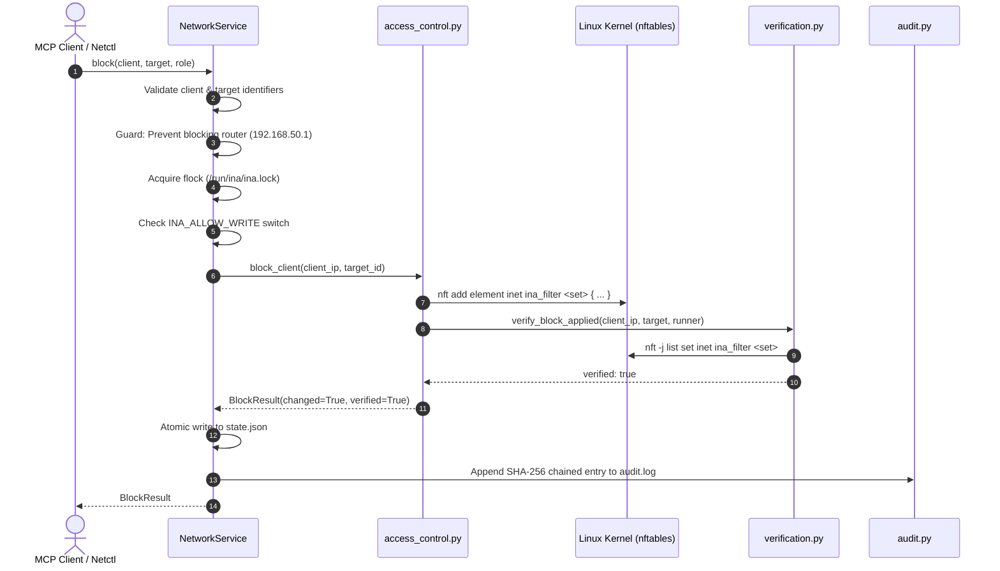

# Tool Reference: `block_client`

The `block_client` tool isolates or restricts IPv4 network communication for a specific Wi-Fi client on the local network (`192.168.50.0/24`) without disconnecting the client from the Wi-Fi access point.

---

## 1. Scope & Network Semantics

### What the Tool Does

- **Layer 3 / Layer 4 Filtering:** Enforces bidirectional or egress packet filtering using the Linux kernel `nftables` framework (`inet ina_filter` table).
- **Zero Wi-Fi Disconnection:** The client **remains connected** to the 802.11 access point (`ap0`). Its Wi-Fi association is maintained, and its ARP neighbor entry remains active (`REACHABLE` or `STALE`).
- **Core Infrastructure Preservation:** Crucial local router services—specifically **DHCP (UDP port 67)** and **DNS (UDP/TCP port 53)**—remain accessible so the client retains its IP lease and network stack integrity without triggering operating system captive portal warnings or disconnection loops.
- **Immediate Rejection:** Dropped packets return an ICMP administrative prohibited signal (`counter reject with icmpx admin-prohibited`), notifying application sockets immediately rather than hanging on silent timeouts.

### What the Tool Leaves Untouched

- **Bandwidth Limits:** Does not create, modify, or remove traffic control (`tc`) rate shaping classes.
- **Wireless Associations:** Does not deauthenticate (`hostapd_cli deauthenticate`) or ban (`hostapd.deny`) the station.
- **Unrelated Clients:** Packets between unaffected clients and the router flow normally.

### Supported Target Scopes

The `target` parameter accepts four distinct target categories:

| Target Scope           | Target Value Example              | Action Performed                                                                                                                                                          |
| :--------------------- | :-------------------------------- | :------------------------------------------------------------------------------------------------------------------------------------------------------------------------ |
| **Peer Client**  | `laptop-b` or `192.168.50.21` | Blocks peer-to-peer IPv4 forwarding between the two clients **in both directions**. Internet and gateway access remain open.                                        |
| **`gateway`**  | `gateway`                       | Blocks client communication destined for the router host (`192.168.50.1`), except DHCP (UDP 67) and DNS (UDP/TCP 53).                                                   |
| **`internet`** | `internet`                      | Blocks client traffic forwarded through the uplink interface (`wlan0`) to external destinations, dropping outbound and return flows. Peer-to-peer traffic remains open. |
| **`all`**      | `all`                           | Full quarantine: blocks peer-to-peer forwarding, uplink Internet access, and Pi host services (preserving only DHCP/DNS).                                                 |

---

## 2. API & Schema Specification

### Input Arguments (`BlockClientArgs`)

| Parameter  | Type       |   Required   | Constraints / Validation                                                               | Description                                                                             |
| :--------- | :--------- | :-----------: | :------------------------------------------------------------------------------------- | :-------------------------------------------------------------------------------------- |
| `client` | `string` | **Yes** | Pattern: `^([a-z0-9][a-z0-9-]{0,62}\|192\.168\.50\.[0-9]{1,3})$`                      | Client reservation name (e.g. `laptop-a`) or IPv4 address within `192.168.50.0/24`. |
| `target` | `string` | **Yes** | Pattern: `^([a-z0-9][a-z0-9-]{0,62}\|192\.168\.50\.[0-9]{1,3}\|gateway\|internet\|all)$` | Target peer client name/IP, or scope keyword: `gateway`, `internet`, or `all`.    |

### Return Model (`BlockResult`)

| Field         | Type              | Description                                                                         |
| :------------ | :---------------- | :---------------------------------------------------------------------------------- |
| `client`    | `string`        | Client identifier provided in invocation.                                           |
| `client_ip` | `string`        | Fully resolved IPv4 address in `192.168.50.0/24`.                                 |
| `target`    | `string`        | Evaluated target client or scope keyword.                                           |
| `blocked`   | `boolean`       | `true` if traffic is blocked following this call.                                 |
| `changed`   | `boolean`       | `true` if a new kernel rule was added; `false` if already present (idempotent). |
| `verified`  | `boolean`       | `true` if rule presence was verified in live kernel state.                        |
| `message`   | `string \| null` | Diagnostic details or verification output.                                          |

### MCP Annotations & Permissions

- **MCP Annotations:** `destructive_hint=True`, `idempotent_hint=True`, `open_world_hint=False`, `read_only_hint=False`.
- **Role Requirements:** Allowed for `admin` and `operator`. Denied for `viewer`.

---

## 3. Implementation Details

- **MCP Wrapper:** [`inav2/mcp_server/tools.py`](file:///home/dhruvv_w/Documents/ina/inav2/mcp_server/tools.py) (`block_client`)
- **Authoritative Pipeline:** [`inav2/network/service.py`](file:///home/dhruvv_w/Documents/ina/inav2/network/service.py) (`NetworkService.block`)
- **Kernel Primitive:** [`inav2/network/access_control.py`](file:///home/dhruvv_w/Documents/ina/inav2/network/access_control.py) (`block_client`)
- **Kernel Verification:** [`inav2/network/verification.py`](file:///home/dhruvv_w/Documents/ina/inav2/network/verification.py) (`verify_block_applied`)

### Underlying `nftables` Sets

Rules are added to specific sets in table `inet ina_filter`:

```bash
# 1. Peer-to-peer block (symmetric pair elements):
nft add element inet ina_filter blocked_pairs { 192.168.50.20 . 192.168.50.21, 192.168.50.21 . 192.168.50.20 }

# 2. Internet uplink block:
nft add element inet ina_filter blocked_internet { 192.168.50.20 }

# 3. Router gateway services block:
nft add element inet ina_filter blocked_gateway { 192.168.50.20 }

# 4. Complete quarantine ('all'):
nft add element inet ina_filter isolated { 192.168.50.20 }
```

Matching packets are evaluated in `forward` and `input` chains:

```text
ip saddr . ip daddr @blocked_pairs counter reject with icmpx admin-prohibited
ip saddr @blocked_internet oifname "wlan0" counter reject with icmpx admin-prohibited
ip saddr @blocked_gateway ip daddr 192.168.50.1 udp dport != { 67, 53 } counter reject with icmpx admin-prohibited
ip saddr @isolated counter reject with icmpx admin-prohibited
```

---

## 4. Execution Flow & Lifecycle Safeguards



### Automated Rollback

If the `nft` command encounters an error or `verification.py` fails to confirm that the element exists in kernel memory:

1. `access_control.py` automatically catches the exception.
2. It executes compensating `nft delete element` commands to remove any partial set entries.
3. It raises a `RuntimeError` wrapped as an MCP `ToolError` (`isError: true`).

---

## 5. Error Handling & Edge Cases

| Scenario                  | Handled Condition                         | Behavior                                                                                           |
| :------------------------ | :---------------------------------------- | :------------------------------------------------------------------------------------------------- |
| **Protected IP**    | Target is router IP `192.168.50.1`      | Raises `PermissionError: Cannot block protected router infrastructure (192.168.50.1).`           |
| **Unknown Client**  | Identifier not found in DHCP reservations | Raises `ClientNotFoundError: Unknown client 'printer-x'.`                                        |
| **Self-Lockout**    | Target matches current `SSH_CLIENT` IP  | Denies operation before lock acquisition to prevent disconnecting the admin session.               |
| **Write Protected** | `INA_ALLOW_WRITE=0`                     | Raises `PermissionError: Write operations are disabled by INA_ALLOW_WRITE configuration.`        |
| **Idempotent Call** | Rule already active in kernel             | Returns `changed=False`, `blocked=True`, `verified=True` without re-running kernel commands. |

---

## 6. Usage Examples

### MCP JSON-RPC Request

```json
{
  "jsonrpc": "2.0",
  "id": 1,
  "method": "tools/call",
  "params": {
    "name": "block_client",
    "arguments": {
      "client": "laptop-a",
      "target": "internet"
    }
  }
}
```

### MCP Success Response

```json
{
  "jsonrpc": "2.0",
  "id": 1,
  "result": {
    "client": "laptop-a",
    "client_ip": "192.168.50.20",
    "target": "internet",
    "blocked": true,
    "changed": true,
    "verified": true,
    "message": "Blocked laptop-a (192.168.50.20) from internet."
  }
}
```

### CLI Equivalent (`ina-netctl`)

```bash
# Block laptop-a from internet
ina-netctl block laptop-a internet

# Block laptop-a from communicating with phone-b
ina-netctl block 192.168.50.20 192.168.50.21
```
