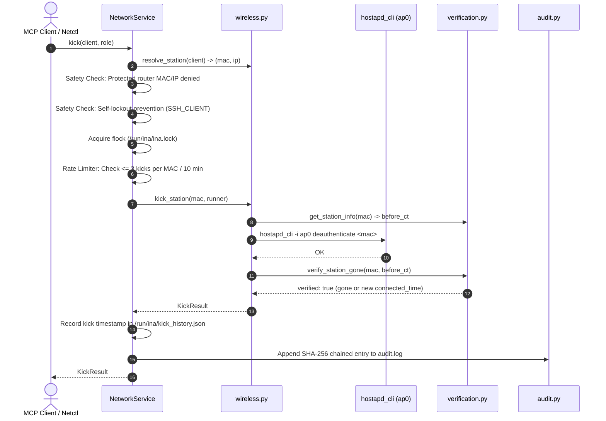

# Tool Reference: `kick_client`

The `kick_client` tool sends a one-time 802.11 deauthentication frame to a target wireless station, forcing it to disconnect immediately from the INA Wi-Fi network. Because no ban is applied, standard client devices will typically renegotiate and reassociate within seconds.

---

## 1. Scope & Network Semantics

### What the Tool Does
- **Layer 2 (802.11) Deauthentication:** Instructs the Wi-Fi daemon (`hostapd`) via its control socket interface (`/run/hostapd/ap0`) to issue an 802.11 deauthenticate frame to the client's MAC address.
- **Immediate Disconnection:** The station's current Wi-Fi session is terminated immediately.
- **Temporary Impact:** The client **is not banned**. Its MAC remains permitted on the access point, and standard wireless supplicants (e.g. phones, laptops) will immediately attempt to reconnect.
- **Station Resolution:** Accepts a client hostname, IPv4 address in `192.168.50.0/24`, or hardware MAC address (`xx:xx:xx:xx:xx:xx`).

### What the Tool Leaves Untouched
- **IP Packet Filtering:** Does not create or remove `nftables` rules in `inet ina_filter`.
- **Bandwidth Limits:** Does not modify `tc` traffic shaping classes.
- **Persistent Access Control:** Does not add the MAC address to `/etc/hostapd/hostapd.deny` or runtime MAC ACLs.
- **Other Associated Stations:** Other Wi-Fi stations remain completely unaffected.

---

## 2. API & Schema Specification

### Input Arguments (`KickClientArgs`)
| Parameter | Type | Required | Constraints / Validation | Description |
| :--- | :--- | :---: | :--- | :--- |
| `client` | `string` | **Yes** | Pattern: `^([a-z0-9][a-z0-9-]{0,62}\|192\.168\.50\.[0-9]{1,3}\|[0-9a-fA-F]{2}(:[0-9a-fA-F]{2}){5})$` | Client reservation name (e.g. `phone-b`), IPv4 address, or 48-bit MAC address. |

### Return Model (`KickResult`)
| Field | Type | Description |
| :--- | :--- | :--- |
| `client` | `string` | Client identifier provided in invocation. |
| `client_ip` | `string \| null` | Resolved IPv4 address, if known. |
| `mac` | `string` | Normalized colon-separated MAC address acted on. |
| `was_associated` | `boolean` | `true` if the station was actively associated before deauthentication. |
| `kicked` | `boolean` | `true` if `hostapd` accepted the deauthentication command. |
| `reconnected` | `boolean \| null` | `true` if the client re-associated during the post-kick verification check. |
| `changed` | `boolean` | `true` if a deauthentication frame was dispatched. |
| `verified` | `boolean` | `true` if the previous association was verified gone. |
| `message` | `string \| null` | Diagnostic details or verification output. |

### MCP Annotations & Permissions
- **MCP Annotations:** `destructive_hint=True`, `idempotent_hint=False`, `open_world_hint=False`, `read_only_hint=False`.
- **Role Requirements:** Allowed for `admin` and `operator`. Denied for `viewer`.

---

## 3. Implementation Details

- **MCP Wrapper:** [`inav2/mcp_server/tools.py`](../../mcp_server/tools.py) (`kick_client`)
- **Authoritative Pipeline:** [`inav2/network/service.py`](../../network/service.py) (`NetworkService.kick`)
- **Wireless Primitive:** [`inav2/network/wireless.py`](../../network/wireless.py) (`kick_station`)
- **Wireless Verification:** [`inav2/network/verification.py`](../../network/verification.py) (`verify_station_gone`, `get_station_info`)

### Underlying Control Commands
Commands communicate with `hostapd` using direct binary arguments (`shell=False`):

```bash
# Query station connection status and connected_time:
hostapd_cli -i ap0 sta 3a:1f:9c:22:7e:10

# Dispatch 802.11 deauthentication frame:
hostapd_cli -i ap0 deauthenticate 3a:1f:9c:22:7e:10
```

---

## 4. Execution Flow & Lifecycle Safeguards



### Critical Safeguards

1. **Sliding-Window Rate Limiting:**
   - Enforces a strict rate limit of **maximum 3 kicks per MAC per 10 minutes (600 seconds)**.
   - Kick timestamps are tracked in `/run/ina/kick_history.json`.
   - If the limit is exceeded, `RateLimitError` is raised, preventing deauthentication flooding attacks.
2. **Self-Lockout Prevention:**
   - Inspects the `SSH_CLIENT` environment variable. If the caller connects from the target station's IP or MAC, the operation is denied before executing any commands.
3. **Protected Infrastructure Guard:**
   - Router IP (`192.168.50.1`), known gateway MACs, and entries in `protected_macs` cannot be kicked.

---

## 5. Usage Examples

### MCP JSON-RPC Request
```json
{
  "jsonrpc": "2.0",
  "id": 6,
  "method": "tools/call",
  "params": {
    "name": "kick_client",
    "arguments": {
      "client": "phone-b"
    }
  }
}
```

### MCP Success Response
```json
{
  "jsonrpc": "2.0",
  "id": 6,
  "result": {
    "client": "phone-b",
    "client_ip": "192.168.50.21",
    "mac": "3a:1f:9c:22:7e:10",
    "was_associated": true,
    "kicked": true,
    "reconnected": true,
    "changed": true,
    "verified": true,
    "message": "Station 3a:1f:9c:22:7e:10 deauthenticated (reconnected within verify window)."
  }
}
```

### CLI Equivalent (`ina-netctl`)
```bash
# Kick phone-b off the Wi-Fi
ina-netctl kick phone-b

# Kick by MAC address
ina-netctl kick 3a:1f:9c:22:7e:10
```

