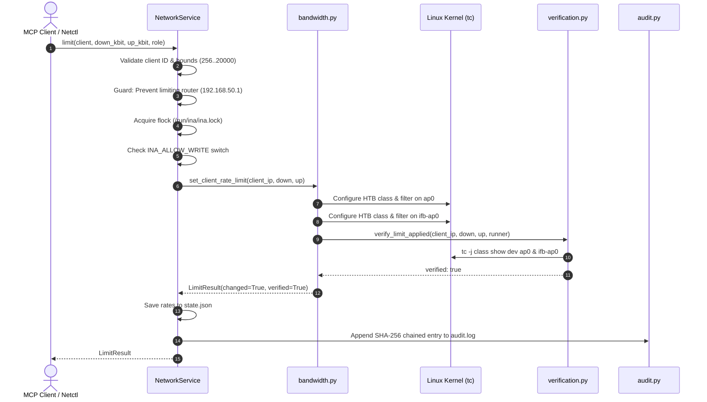

# Tool Reference: `limit_bandwidth`

The `limit_bandwidth` tool establishes fine-grained egress and ingress bandwidth caps on a client's aggregate network throughput using the Linux Traffic Control (`tc`) subsystem.

---

## 1. Scope & Network Semantics

### What the Tool Does
- **Dual-Direction Rate Limiting:** Caps both download (traffic sent from router/Internet to client) and upload (traffic sent from client to router/Internet).
- **Aggregate Ceilings:** The limits apply across **all destinations combined** (peer devices, local router services, and the WAN uplink).
- **Asymmetric Rate Support:** Supports distinct values for download and upload (e.g. 5000 kbit/s down, 1000 kbit/s up).
- **Hierarchical Token Bucket (HTB):** Uses class-based queuing (`sch_htb`) with Stochastic Fairness Queueing (`sfq`) leaf disciplines to prevent TCP socket starvation among multiple streams.
- **Dynamic Updates:** Calling `limit_bandwidth` on an already-throttled client updates the rate ceiling in-place (`tc class change`).

### What the Tool Leaves Untouched
- **IP Packet Filtering:** Does not create or remove `nftables` blocking rules. Throttling and blocking operate independently.
- **Wi-Fi Association:** The client remains fully associated with the AP.
- **Other Clients:** Bandwidth shaping is per-client; non-throttled clients continue at unconstrained line rates.

---

## 2. API & Schema Specification

### Input Arguments (`LimitBandwidthArgs`)
| Parameter | Type | Required | Constraints / Validation | Description |
| :--- | :--- | :---: | :--- | :--- |
| `client` | `string` | **Yes** | Pattern: `^([a-z0-9][a-z0-9-]{0,62}\|192\.168\.50\.[0-9]{1,3})$` | Client reservation name (e.g. `laptop-a`) or IPv4 address within `192.168.50.0/24`. |
| `download_kbit` | `integer` | **Yes** | Range: `256` to `20000` (kbit/s) | Egress download ceiling ($256\text{ kbit/s} \le \text{rate} \le 20\text{ Mbit/s}$). |
| `upload_kbit` | `integer` | **Yes** | Range: `256` to `20000` (kbit/s) | Ingress upload ceiling ($256\text{ kbit/s} \le \text{rate} \le 20\text{ Mbit/s}$). |

### Return Model (`LimitResult`)
| Field | Type | Description |
| :--- | :--- | :--- |
| `client` | `string` | Client identifier provided in invocation. |
| `client_ip` | `string` | Resolved IPv4 address of the client. |
| `download_kbit` | `integer` | Active download rate ceiling in kbit/s. |
| `upload_kbit` | `integer` | Active upload rate ceiling in kbit/s. |
| `changed` | `boolean` | `true` if class was created or rates changed; `false` if already at requested rates. |
| `verified` | `boolean` | `true` if HTB classes were confirmed in live kernel state. |
| `message` | `string \| null` | Diagnostic details or verification output. |

### MCP Annotations & Permissions
- **MCP Annotations:** `destructive_hint=True`, `idempotent_hint=True`, `open_world_hint=False`, `read_only_hint=False`.
- **Role Requirements:** Allowed for `admin` and `operator`. Denied for `viewer`.

---

## 3. Implementation Details

- **MCP Wrapper:** [`inav2/mcp_server/tools.py`](file:///home/dhruvv_w/Documents/ina/inav2/mcp_server/tools.py) (`limit_bandwidth`)
- **Authoritative Pipeline:** [`inav2/network/service.py`](file:///home/dhruvv_w/Documents/ina/inav2/network/service.py) (`NetworkService.limit`)
- **Kernel Primitive:** [`inav2/network/bandwidth.py`](file:///home/dhruvv_w/Documents/ina/inav2/network/bandwidth.py) (`set_client_rate_limit`)
- **Kernel Verification:** [`inav2/network/verification.py`](file:///home/dhruvv_w/Documents/ina/inav2/network/verification.py) (`verify_limit_applied`)

### Traffic Control Architecture
Linux network drivers natively shape egress queues. Ingress shaping requires redirection to an Intermediate Functional Block (`ifb`) pseudo-device:

1. **AP Egress Shaping (`ap0` - Download to client):**
   - Root qdisc: `htb default 10` on `ap0`.
   - Default class: `1:10` (unshaped line-rate traffic).
   - Dedicated class: `1:<class_id>` where `<class_id> = 100 + host_octet` (e.g. `1:120` for `192.168.50.20`).
   - Filter: `flower dst_ip 192.168.50.20/32 classid 1:120`.

2. **AP Ingress Shaping (`ifb-ap0` - Upload from client):**
   - Ingress qdisc: `ingress` on `ap0`.
   - Mirred redirect: `tc filter add dev ap0 parent ffff: protocol ip flower mirred egress redirect dev ifb-ap0`.
   - Root qdisc: `htb default 10` on `ifb-ap0`.
   - Dedicated class: `1:<class_id>` on `ifb-ap0`.
   - Filter: `flower src_ip 192.168.50.20/32 classid 1:120`.

```bash
# Example applied tc commands for 192.168.50.20 (5000k down / 2000k up)
tc class add dev ap0 parent 1:1 classid 1:120 htb rate 5000kbit ceil 5000kbit burst 32k cburst 32k
tc qdisc add dev ap0 parent 1:120 handle 120: sfq perturb 10
tc filter add dev ap0 parent 1:0 protocol ip prio 1 flower dst_ip 192.168.50.20/32 classid 1:120

tc class add dev ifb-ap0 parent 1:1 classid 1:120 htb rate 2000kbit ceil 2000kbit burst 32k cburst 32k
tc qdisc add dev ifb-ap0 parent 1:120 handle 120: sfq perturb 10
tc filter add dev ifb-ap0 parent 1:0 protocol ip prio 1 flower src_ip 192.168.50.20/32 classid 1:120
```

---

## 4. Execution Flow & Lifecycle Safeguards



### Rollback on Failure
If setting up the ingress class on `ifb-ap0` fails after the egress class on `ap0` was applied, `bandwidth.py` automatically tears down the newly created `ap0` class to guarantee atomic, all-or-nothing configuration.

---

## 5. Usage Examples

### MCP JSON-RPC Request
```json
{
  "jsonrpc": "2.0",
  "id": 3,
  "method": "tools/call",
  "params": {
    "name": "limit_bandwidth",
    "arguments": {
      "client": "laptop-a",
      "download_kbit": 5000,
      "upload_kbit": 1000
    }
  }
}
```

### MCP Success Response
```json
{
  "jsonrpc": "2.0",
  "id": 3,
  "result": {
    "client": "laptop-a",
    "client_ip": "192.168.50.20",
    "download_kbit": 5000,
    "upload_kbit": 1000,
    "changed": true,
    "verified": true,
    "message": "Applied bandwidth limits for laptop-a (192.168.50.20): down=5000 kbit/s, up=1000 kbit/s."
  }
}
```

### CLI Equivalent (`ina-netctl`)
```bash
# Limit laptop-a to 5 Mbit/s download, 1 Mbit/s upload
ina-netctl limit laptop-a 5000 1000
```

