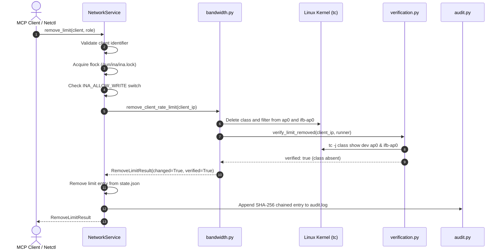

# Tool Reference: `remove_bandwidth_limit`

The `remove_bandwidth_limit` tool dismantles active traffic shaping classes for a client on the router, restoring the device to full, unconstrained line-rate bandwidth.

---

## 1. Scope & Network Semantics

### What the Tool Does
- **Tears Down Traffic Control Classes:** Removes the dedicated Hierarchical Token Bucket (`htb`) class and associated `flower` filter rules from both `ap0` (egress) and `ifb-ap0` (ingress).
- **Line-Rate Restoration:** Unshaped traffic falls through to the root default class (`1:10`), operating at full wireless physical/MAC layer speed.
- **Idempotent Removal:** If the client currently has no active rate limits, the tool cleanly returns `changed=False` without error.

### What the Tool Leaves Untouched
- **IP Packet Blocking:** Does not alter `nftables` blocking rules. If the client is blocked from the Internet or a peer, those blocks remain in effect.
- **Wi-Fi Association:** The client remains connected without disruption.
- **Other Clients:** Only affects the targeted client.

---

## 2. API & Schema Specification

### Input Arguments (`RemoveLimitArgs`)
| Parameter | Type | Required | Constraints / Validation | Description |
| :--- | :--- | :---: | :--- | :--- |
| `client` | `string` | **Yes** | Pattern: `^([a-z0-9][a-z0-9-]{0,62}\|192\.168\.50\.[0-9]{1,3})$` | Client reservation name (e.g. `laptop-a`) or IPv4 address within `192.168.50.0/24`. |

### Return Model (`RemoveLimitResult`)
| Field | Type | Description |
| :--- | :--- | :--- |
| `client` | `string` | Client identifier provided in invocation. |
| `client_ip` | `string` | Resolved IPv4 address of the client. |
| `changed` | `boolean` | `true` if an active limit was removed; `false` if already at line rate. |
| `verified` | `boolean` | `true` if class absence was confirmed from live kernel state. |
| `message` | `string \| null` | Diagnostic details or verification output. |

### MCP Annotations & Permissions
- **MCP Annotations:** `destructive_hint=False`, `idempotent_hint=True`, `open_world_hint=False`, `read_only_hint=False`.
- **Role Requirements:** Allowed for `admin` and `operator`. Denied for `viewer`.

---

## 3. Implementation Details

- **MCP Wrapper:** [`inav2/mcp_server/tools.py`](file:///home/dhruvv_w/Documents/ina/inav2/mcp_server/tools.py) (`remove_bandwidth_limit`)
- **Authoritative Pipeline:** [`inav2/network/service.py`](file:///home/dhruvv_w/Documents/ina/inav2/network/service.py) (`NetworkService.remove_limit`)
- **Kernel Primitive:** [`inav2/network/bandwidth.py`](file:///home/dhruvv_w/Documents/ina/inav2/network/bandwidth.py) (`remove_client_rate_limit`)
- **Kernel Verification:** [`inav2/network/verification.py`](file:///home/dhruvv_w/Documents/ina/inav2/network/verification.py) (`verify_limit_removed`)

### Underlying Kernel Commands
The tool derives the class ID from the IP's 4th octet (`<class_id> = 100 + octet`) and removes the filters and classes:

```bash
# Egress deletion on ap0:
tc filter del dev ap0 parent 1:0 protocol ip prio 1 flower dst_ip 192.168.50.20/32
tc class del dev ap0 classid 1:120

# Ingress deletion on ifb-ap0:
tc filter del dev ifb-ap0 parent 1:0 protocol ip prio 1 flower src_ip 192.168.50.20/32
tc class del dev ifb-ap0 classid 1:120
```

---

## 4. Execution Flow & Lifecycle Safeguards



### Verification
- **Read-Back Verification:** Runs `tc -j class show dev ap0` and `tc -j class show dev ifb-ap0` and asserts that class `1:<class_id>` is not present.

---

## 5. Usage Examples

### MCP JSON-RPC Request
```json
{
  "jsonrpc": "2.0",
  "id": 4,
  "method": "tools/call",
  "params": {
    "name": "remove_bandwidth_limit",
    "arguments": {
      "client": "laptop-a"
    }
  }
}
```

### MCP Success Response
```json
{
  "jsonrpc": "2.0",
  "id": 4,
  "result": {
    "client": "laptop-a",
    "client_ip": "192.168.50.20",
    "changed": true,
    "verified": true,
    "message": "Removed bandwidth limits for laptop-a (192.168.50.20)."
  }
}
```

### CLI Equivalent (`ina-netctl`)
```bash
# Remove bandwidth limits for laptop-a
ina-netctl unlimit laptop-a
```

