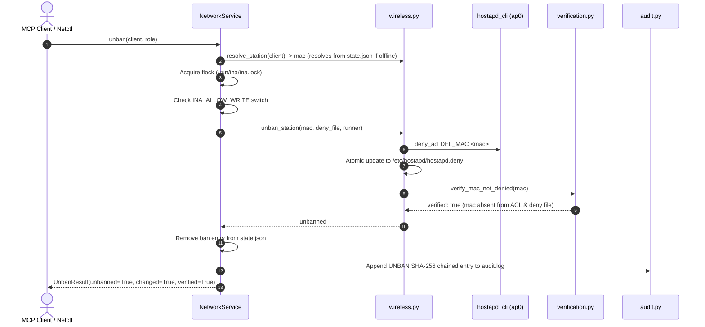

# Tool Reference: `unban_client`

The `unban_client` tool removes an active Layer 2 Wi-Fi ban previously applied to a device, permitting its MAC address to reassociate with the INA Wi-Fi network.

---

## 1. Scope & Network Semantics

### What the Tool Does
- **Layer 2 (802.11) ACL Removal:** Removes the station's MAC address from `hostapd`'s runtime Access Control List (`deny_acl DEL_MAC`) and removes it from the persistent deny file (`/etc/hostapd/hostapd.deny`).
- **Permits Association:** The client device is now permitted to complete 802.11 authentication and association frames with the access point.
- **Disconnected Resolution:** Resolves station identifiers even if the device is disconnected and has no active DHCP lease by inspecting previous ban records in `/var/lib/ina/state.json`.
- **Idempotent Execution:** If the device is not currently banned, `changed=False` is returned cleanly without errors.

### What the Tool Leaves Untouched
- **IP Packet Filtering:** Does not create or remove `nftables` rules in `inet ina_filter`.
- **Bandwidth Limits:** Does not alter `tc` rate limits.
- **Client Wi-Fi Stack:** The tool does not force the client device to connect; it removes the prohibition so the client device's OS can connect according to its own wireless roaming policy.

---

## 2. API & Schema Specification

### Input Arguments (`UnbanClientArgs`)
| Parameter | Type | Required | Constraints / Validation | Description |
| :--- | :--- | :---: | :--- | :--- |
| `client` | `string` | **Yes** | Pattern: `^([a-z0-9][a-z0-9-]{0,62}\|192\.168\.50\.[0-9]{1,3}\|[0-9a-fA-F]{2}(:[0-9a-fA-F]{2}){5})$` | Client reservation name (e.g. `phone-b`), IPv4 address, or MAC address. |

### Return Model (`UnbanResult`)
| Field | Type | Description |
| :--- | :--- | :--- |
| `client` | `string` | Client identifier provided in invocation. |
| `mac` | `string` | Normalized colon-separated MAC address. |
| `unbanned` | `boolean` | `true` if the station MAC is no longer denied following this call. |
| `changed` | `boolean` | `true` if a ban was removed; `false` if already absent (idempotent). |
| `verified` | `boolean` | `true` if MAC absence from deny ACL and deny file was verified. |
| `message` | `string \| null` | Diagnostic details or verification output. |

### MCP Annotations & Permissions
- **MCP Annotations:** `destructive_hint=False`, `idempotent_hint=True`, `open_world_hint=False`, `read_only_hint=False`.
- **Role Requirements:** Allowed for `admin` and `operator`. Denied for `viewer`.

---

## 3. Implementation Details

- **MCP Wrapper:** [`inav2/mcp_server/tools.py`](file:///home/dhruvv_w/Documents/ina/inav2/mcp_server/tools.py) (`unban_client`)
- **Authoritative Pipeline:** [`inav2/network/service.py`](file:///home/dhruvv_w/Documents/ina/inav2/network/service.py) (`NetworkService.unban`)
- **Wireless Primitive:** [`inav2/network/wireless.py`](file:///home/dhruvv_w/Documents/ina/inav2/network/wireless.py) (`unban_station`)
- **Wireless Verification:** [`inav2/network/verification.py`](file:///home/dhruvv_w/Documents/ina/inav2/network/verification.py) (`verify_mac_not_denied`)

### Underlying Commands & File Operations
```bash
# 1. Remove MAC from hostapd runtime deny ACL:
hostapd_cli -i ap0 deny_acl DEL_MAC 3a:1f:9c:22:7e:10

# 2. Atomically remove MAC from /etc/hostapd/hostapd.deny:
# (Reads existing entries, filters out target MAC, writes to tmp and replaces)

# 3. Read back live ACL and deny file to verify absence:
hostapd_cli -i ap0 deny_acl SHOW
```

---

## 4. Execution Flow & Lifecycle Safeguards



---

## 5. Usage Examples

### MCP JSON-RPC Request
```json
{
  "jsonrpc": "2.0",
  "id": 9,
  "method": "tools/call",
  "params": {
    "name": "unban_client",
    "arguments": {
      "client": "phone-b"
    }
  }
}
```

### MCP Success Response
```json
{
  "jsonrpc": "2.0",
  "id": 9,
  "result": {
    "client": "phone-b",
    "mac": "3a:1f:9c:22:7e:10",
    "unbanned": true,
    "changed": true,
    "verified": true,
    "message": "Unbanned phone-b (3a:1f:9c:22:7e:10) on AP ap0."
  }
}
```

### CLI Equivalent (`ina-netctl`)
```bash
# Unban phone-b
ina-netctl unban phone-b

# Unban by MAC address
ina-netctl unban 3a:1f:9c:22:7e:10
```

