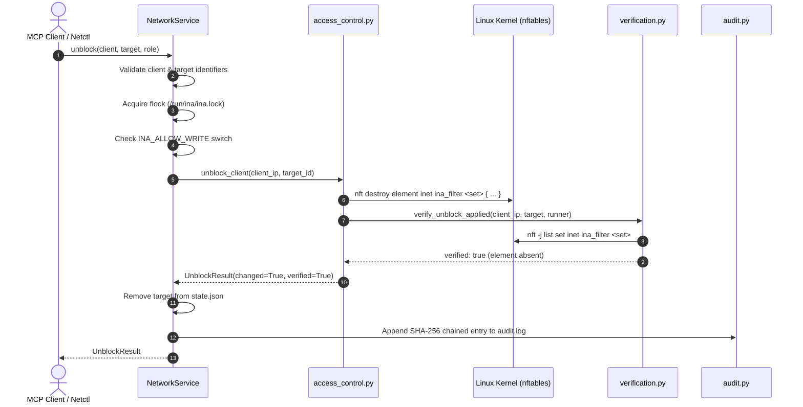

# Tool Reference: `unblock_client`

The `unblock_client` tool removes an active packet filtering rule previously set by `block_client`, restoring IPv4 communication between a client and a target peer, gateway, or external network.

---

## 1. Scope & Network Semantics

### What the Tool Does
- **Targeted Rule Destruction:** Removes the client's IP from the specific `nftables` set (`blocked_pairs`, `blocked_internet`, `blocked_gateway`, or `isolated`) in the `inet ina_filter` table.
- **Immediate Traffic Restoration:** Packets to the unblocked destination are permitted through the forwarding or input chains immediately.
- **Idempotent Removal:** In modern nftables, deleting non-existent elements using `destroy element` is idempotent and safe. If the rule was already absent, `changed=False` is returned cleanly.

### What the Tool Leaves Untouched
- **Bandwidth Limits:** Does not modify traffic control (`tc`) rate limits. A throttled client remains throttled at its configured rate after being unblocked.
- **Other Active Blocks:** If a client had multiple specific blocks applied (e.g. blocked from `phone-b` and also blocked from `laptop-c`), unblocking `phone-b` does not alter the block on `laptop-c`.
- **Wireless Layer:** Does not affect 802.11 association or MAC ban status in `hostapd`.

---

## 2. API & Schema Specification

### Input Arguments (`UnblockClientArgs`)
| Parameter | Type | Required | Constraints / Validation | Description |
| :--- | :--- | :---: | :--- | :--- |
| `client` | `string` | **Yes** | Pattern: `^([a-z0-9][a-z0-9-]{0,62}\|192\.168\.50\.[0-9]{1,3})$` | Client reservation name (e.g. `laptop-a`) or IPv4 address within `192.168.50.0/24`. |
| `target` | `string` | **Yes** | Pattern: `^([a-z0-9][a-z0-9-]{0,62}\|192\.168\.50\.[0-9]{1,3}\|gateway\|internet\|all)$` | Target peer client name/IP, or scope keyword: `gateway`, `internet`, or `all`. |

### Return Model (`UnblockResult`)
| Field | Type | Description |
| :--- | :--- | :--- |
| `client` | `string` | Client identifier as provided in invocation. |
| `client_ip` | `string` | Resolved IPv4 address of the client. |
| `target` | `string` | Target client or scope unblocked. |
| `unblocked` | `boolean` | `true` if traffic is unblocked following this call. |
| `changed` | `boolean` | `true` if an existing kernel rule was removed; `false` if already unblocked. |
| `verified` | `boolean` | `true` if rule absence was confirmed from live kernel state. |
| `message` | `string \| null` | Diagnostic details or verification output. |

### MCP Annotations & Permissions
- **MCP Annotations:** `destructive_hint=False`, `idempotent_hint=True`, `open_world_hint=False`, `read_only_hint=False`.
- **Role Requirements:** Allowed for `admin` and `operator`. Denied for `viewer`.

---

## 3. Implementation Details

- **MCP Wrapper:** [`inav2/mcp_server/tools.py`](file:///home/dhruvv_w/Documents/ina/inav2/mcp_server/tools.py) (`unblock_client`)
- **Authoritative Pipeline:** [`inav2/network/service.py`](file:///home/dhruvv_w/Documents/ina/inav2/network/service.py) (`NetworkService.unblock`)
- **Kernel Primitive:** [`inav2/network/access_control.py`](file:///home/dhruvv_w/Documents/ina/inav2/network/access_control.py) (`unblock_client`)
- **Kernel Verification:** [`inav2/network/verification.py`](file:///home/dhruvv_w/Documents/ina/inav2/network/verification.py) (`verify_unblock_applied`)

### Underlying Kernel Commands
The tool uses `nft destroy element` to avoid race conditions or errors when removing elements:

```bash
# 1. Peer-to-peer unblock (removes bidirectional pairs):
nft destroy element inet ina_filter blocked_pairs { 192.168.50.20 . 192.168.50.21, 192.168.50.21 . 192.168.50.20 }

# 2. Internet unblock:
nft destroy element inet ina_filter blocked_internet { 192.168.50.20 }

# 3. Gateway unblock:
nft destroy element inet ina_filter blocked_gateway { 192.168.50.20 }

# 4. Quarantine removal ('all'):
nft destroy element inet ina_filter isolated { 192.168.50.20 }
```

---

## 4. Execution Flow & Lifecycle Safeguards



### Verification & Rollback
- **Read-Back Verification:** Queries the set via `nft -j list set inet ina_filter <set>` and confirms that the tuple or address is completely absent.
- **Rollback on Error:** If an unexpected kernel command failure occurs during unblocking, the system catches the exception and logs an audit failure record.

---

## 5. Usage Examples

### MCP JSON-RPC Request
```json
{
  "jsonrpc": "2.0",
  "id": 2,
  "method": "tools/call",
  "params": {
    "name": "unblock_client",
    "arguments": {
      "client": "laptop-a",
      "target": "internet"
    }
  }
}
```

### MCP Success Response
```json
{
  "jsonrpc": "2.0",
  "id": 2,
  "result": {
    "client": "laptop-a",
    "client_ip": "192.168.50.20",
    "target": "internet",
    "unblocked": true,
    "changed": true,
    "verified": true,
    "message": "Unblocked laptop-a (192.168.50.20) from internet."
  }
}
```

### CLI Equivalent (`ina-netctl`)
```bash
# Unblock laptop-a from internet
ina-netctl unblock laptop-a internet

# Restore communication between laptop-a and phone-b
ina-netctl unblock laptop-a phone-b
```

